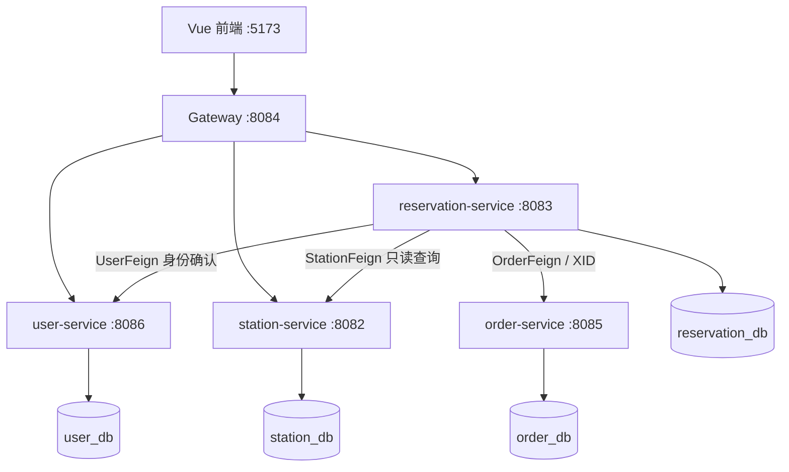

# SmartCharge Park

基于 Spring Cloud 微服务架构的智慧停车与新能源汽车充电预约平台。项目围绕新能源车主出发前选择充电站、确认预约容量并锁定合适时段的问题，提供站点查询到待支付订单的演示闭环。

## 快速开始

普通 Windows 用户使用项目内的一键入口，无需预装 IDEA、Git、Java、Maven、Node.js、MySQL、Nacos 或 Seata。

| 操作 | 入口 |
| --- | --- |
| 首次联网安装并启动 | [setup/install-and-run.cmd](setup/install-and-run.cmd) |
| 后续启动 | [setup/start-all.cmd](setup/start-all.cmd) |
| 停止并保留数据 | [setup/stop-all.cmd](setup/stop-all.cmd) |

运行条件为 Windows 10/11 x64、Windows PowerShell 5.1、首次联网；缺少 Microsoft VC++ Runtime 时按安装提示处理。安装器使用被 Git 忽略的 `.runtime` 保存私有运行环境、数据和凭据。安装、重启与重复安装已在本机含中文及空格路径的隔离副本中验证。

启动后打开 <http://127.0.0.1:5173>。`driver`、`driver2` 的演示密码均为 `123456`，仅供本地课程演示，与基础设施凭据无关。

详细操作见 [Windows 安装指南](setup/README_INSTALL.md)；手动开发调试见 [LOCAL_RUN.md](LOCAL_RUN.md)。

## 核心功能

站点查询 → 查看公开信息与状态快照 → 选择日期和时段 → 校验预约容量 → 创建预约 → 创建待支付订单。

- 持久化用户账号、登录与当前身份查询。
- 10 个重庆北碚公开站点的列表、关键词搜索和详情展示；类型、功率、价格与停车政策帮助用户人工选择。
- 预约日期、时段和剩余模拟容量查询，以及容量检查与并发冲突控制。
- 通过 Gateway 提交已登录用户的预约，跨服务写入预约和待支付订单。
- Nacos 注册发现与预约配置刷新、Sentinel 服务保护、Seata AT 全局提交及受控回滚验证。
- SkyWalking Java Agent 覆盖五个 Java 应用，可查看同一请求的跨服务 Trace、Feign 调用与拓扑。

预约身份由 Bearer Token 对应的真实用户确定，客户端伪造的 userId 不作为身份依据。Token 为随机不透明令牌；新登录替换同一用户的旧令牌，不影响其他用户。

## 微服务架构

正式结构为 **四个业务微服务 + 一个 Gateway + Vue 前端**。

| 服务 | 数据与职责 |
| --- | --- |
| user-service | user_db；账号、登录和基础身份 |
| station-service | station_db；站点列表、搜索和详情 |
| reservation-service | reservation_db；预约、容量检查和全局事务编排 |
| order-service | order_db；内部订单创建和本地事务 |
| gateway-service | 无业务数据库；显式路由、认证入口、CORS、访问日志和响应头 |
| common-web | 公共 Web 库；MVC 统一错误响应与异常处理，不是独立微服务 |

四个业务服务通过 Spring Boot 自动配置复用 `common-web`，错误统一为 `status/code/message/path`，成功响应保持原业务 DTO。Gateway 继续使用自身的 Reactive 认证错误处理。

Gateway 通过 Nacos 服务发现转发 `/api/auth/**`、`/api/stations/**`、`/api/reservations/**`，没有公开订单路由。浏览器业务请求统一访问 `http://127.0.0.1:8084/api`。

Gateway 对保护接口通过负载均衡 WebClient 调用 user-service 验证不透明 Bearer Token，清除客户端同名身份 Header 后注入真实用户 ID 与角色。预约服务仍通过 UserFeign 二次确认身份，并核对传入身份是否一致；直连业务服务不能仅凭身份 Header 绕过认证。

采用 Database per Service 与 Flyway per Service：各服务管理自己的 Schema 和迁移。首次安装只准备空 Schema，服务正常启动时由 Flyway 建表、初始化演示数据或执行升级。

预约入口先通过 UserFeign 确认身份，再由 reservation-service 开启全局事务，经 OrderFeign 创建待支付订单。两个写 RM 分别属于 reservation_db 和 order_db；站点与用户查询不增加写分支。XID 由 Starter/OpenFeign 传播。

## 技术栈

| 分类 | 当前技术 |
| --- | --- |
| 后端 | Java 17、Spring Boot 3.5.16 |
| 微服务 | Spring Cloud 2025.0.0、Spring Cloud Alibaba 2025.0.0.0、Gateway、OpenFeign |
| 服务与配置管理 | Nacos Server 3.3.0 |
| 事务与服务保护 | Seata AT 2.5.0、Sentinel 1.8.9 |
| 链路追踪 | SkyWalking OAP/UI 10.1.0、Java Agent 9.8.0；本地 H2 文件存储 |
| 数据 | MySQL 8、MyBatis-Plus、Flyway |
| 前端 | Vue 3、Element Plus、Vite |
| 构建 | Maven 多模块、npm 锁定依赖 |

Sentinel 采用嵌入式客户端及启动恢复规则，不捆绑 Dashboard。版本来源与下载校验见 [安装清单](setup/install-manifest.json)。

## 数据与能力边界

站点名称、地址、充电类型、功率、公开价格和停车政策来自公开页面；空闲数量与页面价格仅代表采集时点快照。项目未接入地图或运营商实时接口。公开评价用于分析导航、入口、占位、功率、收费等问题，不作为本平台原生评论或实际访谈记录。

预约容量、预约记录、待支付订单及估算金额为演示业务数据，不代表现场物理车位或设备保证可用。当前闭环止于待支付订单；真实支付、二维码核销、充电全过程、最终结算、运营 Dashboard，以及 Redis、RocketMQ 尚未接入。
